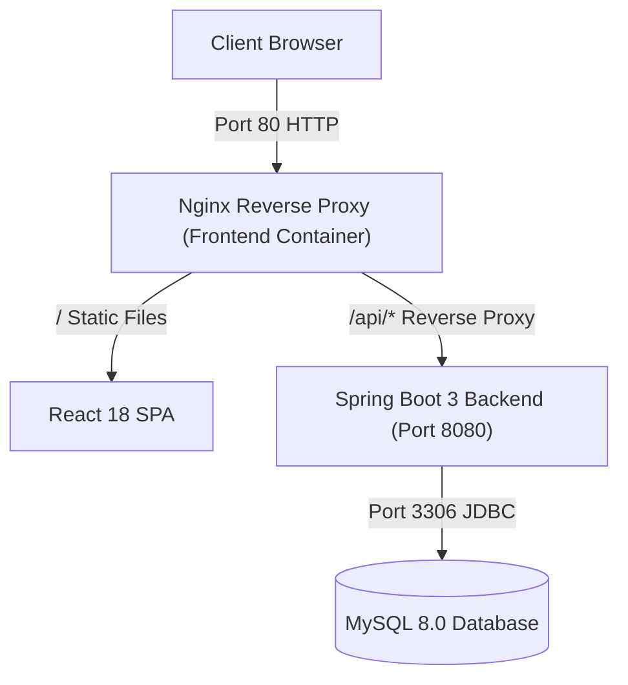

# TaskFlow: Spring Boot + React + MySQL (AWS Free Tier Ready)

A modern, production-ready Full-Stack Todo Application built with **Java 21**, **Spring Boot 3**, **React 18 (Vite)**, and **MySQL 8**, designed specifically to run seamlessly within the **AWS Free Tier** limits.

---

## 🚀 Architecture Overview



- **Frontend**: React 18, Vite, Vanilla CSS design system (Dark mode, glassmorphism, responsive).
- **Backend**: Spring Boot 3.3.4, Java 21, Spring Data JPA, Hibernate, Bean Validation.
- **Database**: MySQL 8.0 with persistent docker volume (also supports in-memory H2 profile for zero-config local runs).
- **Orchestration**: Docker Compose with memory limits optimized for 1GB RAM instances (AWS `t2.micro` / `t3.micro`).

---

## 📂 Project Structure

```text
todo-app/
├── backend/
│   ├── src/main/java/com/example/todo/
│   │   ├── TodoApplication.java
│   │   ├── controller/TodoController.java
│   │   ├── model/Todo.java
│   │   ├── repository/TodoRepository.java
│   │   ├── service/TodoService.java
│   │   ├── dto/ (TodoRequest, TodoResponse)
│   │   └── exception/ (ResourceNotFoundException, GlobalExceptionHandler)
│   ├── src/main/resources/
│   │   ├── application.properties (MySQL production & Docker defaults)
│   │   └── application-h2.properties (In-memory testing profile)
│   ├── Dockerfile
│   └── pom.xml
├── frontend/
│   ├── src/
│   │   ├── components/ (TodoList, TodoItem, TodoForm, FilterBar, StatsCard)
│   │   ├── api/todoApi.js
│   │   ├── App.jsx
│   │   ├── index.css
│   │   └── main.jsx
│   ├── nginx.conf
│   ├── Dockerfile
│   ├── package.json
│   └── vite.config.js
├── docker-compose.yml
├── .env.example
├── aws-deploy-guide.md
└── README.md
```

---

## 🛠️ Quick Start: Running Locally

### Option 1: One-Click with Docker Compose (Recommended)

Make sure Docker Desktop is running, then run:

```bash
docker compose up --build
```

- Open `http://localhost` to view the application.
- API is available at `http://localhost/api/todos` (or `http://localhost:8080/api/todos`).

---

### Option 2: Running Standalone (Without Docker)

#### 1. Backend (with in-memory H2 database)
```bash
cd backend
mvn spring-boot:run -Dspring-boot.run.profiles=h2
```
*Backend runs on `http://localhost:8080`*

#### 2. Frontend
```bash
cd frontend
npm install
npm run dev
```
*Frontend runs on `http://localhost:3000` (automatically proxies `/api` to port 8080)*

---

## 📡 REST API Reference

| Method | Endpoint | Description |
|---|---|---|
| `GET` | `/api/health` | Health check endpoint |
| `GET` | `/api/todos` | List all tasks (supports `?completed=true|false&search=keyword`) |
| `GET` | `/api/todos/{id}` | Get task by ID |
| `POST` | `/api/todos` | Create a task (`{"title": "...", "description": "..."}`) |
| `PUT` | `/api/todos/{id}` | Update task title and description |
| `PATCH` | `/api/todos/{id}/toggle` | Toggle completion status |
| `DELETE` | `/api/todos/{id}` | Delete task |

---

## ☁️ Deploying to AWS Free Tier

See the complete step-by-step guide in:
📄 **[aws-deploy-guide.md](aws-deploy-guide.md)**

Highlights:
- 100% Free Tier eligible using AWS EC2 `t2.micro` or `t3.micro`.
- Includes swap space configuration for stable performance on 1GB RAM machines.
- No separate RDS cost (MySQL runs in container on same EC2 with persistent volume).
- Reverse-proxy Nginx eliminates CORS and SSL friction.
